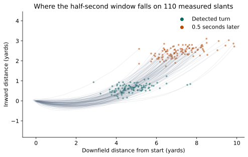
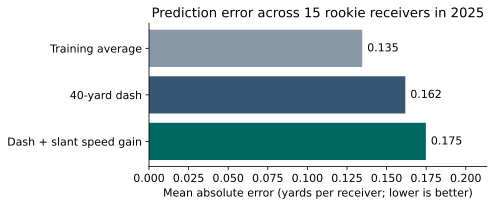

# Does speed gained out of a Combine slant predict rookie separation?

A receiver can run a fast 40 and still take time to accelerate through a change of direction. This study asks whether one more measurement, the speed gained during the first half-second of a left slant break, improves a forecast of separation against NFL man coverage.

**Finding.** Adding the slant measurement increased average error from 0.162 to 0.175 yards across 15 receivers in the 2025 class. The difference was small and uncertain. I would keep this measurement as a prompt for film review and would want stronger evidence before using it to rank prospects.

## Measuring the break

The Combine file contains 110 player attempts of the left slant drill. From the 10 Hz coordinates, the script marks the first sustained inward turn of at least 25 degrees after two yards of downfield movement. It measures the difference between speed at that marker and five frames later, in yards per second. For players with multiple attempts, it takes the median. The marker estimates a change of direction; identifying the exact foot plant would require video validation.

## Testing the link to games

I used the supplied receiver-play separation measure at pass release, including untargeted receivers who ran a recorded route. I kept non-nullified rookie regular-season routes against man coverage. Since a flat and a deep route create different opportunities for separation, I subtracted the typical separation for each route type, measured in the 2023–24 classes. Each receiver's outcome is the median of those differences. Positive values mean the receiver typically had more space than the earlier norm for those route types.

Of 69 receivers with sensor measurements, a dash time and measured NFL routes, 50 had at least 20 eligible routes. I fitted three models on the same 35 receivers from 2023–24 and scored all three on the same 15 receivers from 2025, weighting each receiver equally. The comparison forecasts the adjusted separation outcome using a constant, a linear model with dash time alone, and a linear model with dash time and slant speed gain.

At minimums of 10 and 30 routes, the combined model also had slightly higher error than dash time alone. For the primary 20-route analysis, the approximate 95% interval for improvement from adding the sensor measurement was −0.036 to +0.011 yards, resampling the 15 test players with the fitted models held fixed.

## What a scout can take from this

Gaining speed after a cut is only one part of getting open. A player who carries speed through the break may have little speed to regain. Opponent, pre-snap cushion and time to throw can also change the space available at release. The small test group only includes players with recorded opportunities, and the 2025 class had already appeared in earlier dash-time work. The next test would check the turn markers against film and compare receivers' entry and exit speeds on matched NFL slants before proposing a scouting grade.

## Reproduce

Use Python 3.10 or newer with NumPy, pandas and Matplotlib. Set the data directory to the folder containing combine_results.csv, combine_tracking.csv, games.csv and player_play.csv. The script reports cohort counts, errors and uncertainty and regenerates both figures in this directory.

~~~bash
python -m pip install numpy pandas matplotlib
python slant/analyze.py --data-dir /path/to/competition/csvs
~~~

[2027 Big Data Bowl data](https://www.kaggle.com/competitions/nfl-big-data-bowl-2027/data)
