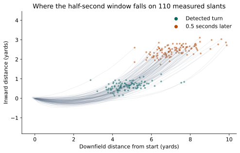
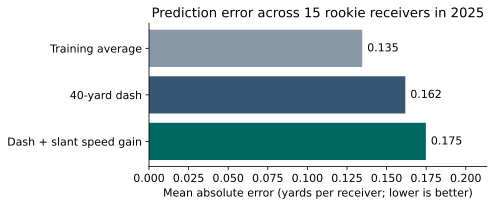
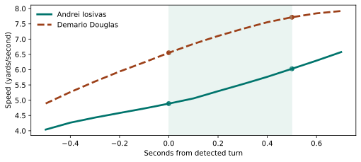

# Does speed gained out of a slant break predict rookie separation?

A scout watching two receivers run the same slant might notice that one accelerates sharply after turning inside. Is that burst evidence that he will get open against NFL man coverage? Across 15 receivers in the 2025 draft class, adding post-turn speed gain to the 40-yard dash increased average prediction error from **0.162 to 0.175 yards**. I would use the drill to select reps for film review. These results give me little reason to use speed gain alone to change a prospect’s grade.

## From a Combine route to a game outcome

I used player positions and speeds recorded ten times per second during the Combine left-slant drill. After the receiver travelled two yards downfield, I marked the first inward turn of at least 25 degrees sustained across two consecutive estimates. I subtracted the speed at that point from the speed half a second later. All 110 recorded attempts yielded a measurement. When a player ran multiple attempts, I used their median gain.

*Figure 1. The measurement window follows each receiver’s turn. The markers estimate when the path bends inward. Video would be needed to identify the foot plant.*

I matched receivers to their rookie regular-season routes against man coverage, including plays where another receiver was targeted. The game outcome was distance to the nearest defender when the quarterback released the ball. To account for route assignments, I subtracted the 2023–24 median separation for that route type from each play. I then took each player’s median across plays. A positive result means that receiver typically had more space than the earlier norm for the routes they ran.

## Did the sensor measurement earn its place?

Sixty-nine receivers had a dash time, a slant measurement and at least one measured NFL route. The main comparison required 20 routes per player. I trained on 35 receivers from 2023–24 and evaluated every forecast on the same 15 receivers from 2025. Each player counted equally.

*Figure 2. Lower error means a more accurate forecast of a receiver’s typical route-adjusted separation.*

| Minimum measured routes | Training receivers | Test receivers | Training average | Dash time | Dash + speed gain |
|---:|---:|---:|---:|---:|---:|
| 10 | 43 | 16 | 0.145 | 0.197 | 0.198 |
| **20** | **35** | **15** | **0.135** | **0.162** | **0.175** |
| 30 | 32 | 14 | 0.139 | 0.168 | 0.173 |

*Mean absolute error in yards per receiver. These thresholds use overlapping groups, so they provide a sensitivity check.*

At 20 routes, the estimated improvement from adding the sensor measurement was **−0.013 yards**. A player-level bootstrap gave an approximate 95% interval of **−0.036 to +0.011 yards**, holding the fitted models fixed. A small benefit remains plausible. The 2025 class had already been examined in the earlier dash-time study, making another draft class a stronger independent test.

## Does the result change on NFL slants?

Across the linked receivers, 335 rookie slants against man coverage had a separation measurement. Requiring five slants per player left 23 training receivers and seven test receivers. Requiring ten left just one test receiver. At the five-route threshold, the average error was 0.475 yards for the training mean, 0.676 for dash time and 0.669 for dash plus gain. After adjusting for the defender’s starting cushion, adding gain improved on dash time by only 0.002 yards. With seven receivers, this is an exploratory finding.

Back in the main, mixed-route comparison, marking the Combine turn one frame earlier or later produced errors of 0.165 and 0.181 yards for dash plus gain. Both exceeded the 0.162-yard dash-only error. Adding speed at the turn as a third predictor also yielded higher error than dash alone (0.173 yards).

## What I would take to a receiver coach

*Figure 3. Iosivas went from 4.89 to 6.03 yards per second in half a second. Douglas went from 6.55 to 7.72. Both gained about 1.15 yards per second.*

I chose these two training receivers using the drill alone. Among receivers with one recorded attempt and gains within 0.05 yards per second of each other, they had the largest difference in speed at the turn. Iosivas finished 0.43 yards above the typical separation for his route mix on 26 measured routes. Douglas finished 0.19 above on 92. Those outcomes describe the players and cannot establish what caused their separation.

A coach can use these traces to pick specific reps for film review. Did the receiver carry speed into the turn? How sharply did he change direction? The next test is to check the estimated turn against film and repeat the forecast on a fresh draft class before giving this measure weight in a prospect grade.

[Executed research notebook](slant-study.ipynb) · [Primary analysis](analyze.py) · [Follow-up analysis](followup.py)
